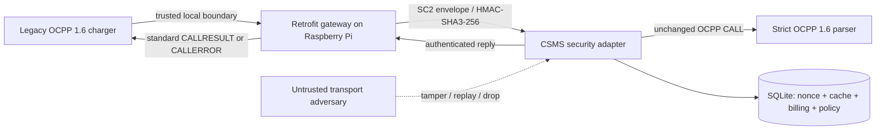

# SecureCharge SC2 architecture

## Trust boundaries and compatibility



The standard parser never sees an outer envelope, `legacy`, `security`, or
`customData`. Compatibility is tested against independently supplied OCPP 1.6
schemas in mobilityhouse/ocpp 2.1.0. Five actions are supported; this is not a
complete CSMS or OCPP certification.

## Message contract

`format`, `ocpp`, and `legacy` are required transport fields. `security` may be
absent for a legacy adapter message; if present, any malformed value is rejected
without fallback. `ocpp` is `[2, uid, action, payload]`.

Security fields are exactly `v`, `kid`, `ts`, `nonce`, `cp`, `tag`. Version is
SC2. The complete CALL and legacy checksum metadata are authenticated along with
all security metadata except the tag itself. Each key ID is assigned to exactly
one charger; the claimed charger must match the receiving connection identity.

```text
tag = HMAC-SHA3-256(key[kid],
      "SecureCharge/SC2 ocpp-integrity\n" ||
      SC-JSON-1({format, ocpp, legacy, security:{v,kid,ts,nonce,cp}}))
```

SC-JSON-1 sorts Python Unicode scalar keys, ASCII-escapes strings, uses no
whitespace, accepts integer magnitudes up to 2^53-1, and disallows duplicate keys,
floats, NaN, invalid Unicode, depth above 24 and encoding size above 64 KiB.
Booleans/null remain JSON literals; integer business fields reject booleans.
It is a specified project format, not RFC 8785. Original meter timestamp and
gateway signing timestamp serve different purposes.

Private-link replies use a different domain-separation label and authenticate
the standard response, request nonce, charger/key, and reply timestamp. The gateway
requires a matching request ID and validates CALLRESULT payload schemas before
forwarding. TLS is still required for remote deployment and confidentiality.

## Verification and accounting order

1. Strict wire JSON parsing and bounded transport structure.
2. Missing security: check global mode and durable per-charger enrollment.
3. Present security: exact structure, supported version, key lookup and MAC.
4. Compare authenticated charger identity and key ownership with receiving identity.
5. Signing freshness: age ≤ 120 s, future skew ≤ 30 s by default.
6. Independent OCPP payload validation.
7. Begin SQLite `BEGIN IMMEDIATE` transaction.
8. Claim `(key_id, nonce)`; duplicates return REPLAY.
9. Resolve `(charge_point_id, uid)` cache. Identical CALL returns saved facts;
   different CALL under the same retained ID returns REQUEST_CONFLICT.
10. Perform business effect, save accepted response facts, persist enrollment and
    audit result in the same transaction; then commit.

SQLite failures roll back the nonce and business state and return STORAGE_ERROR.
An exact authenticated replay is rejected; a retry freshly wrapped by the trusted
gateway is idempotent. If a reply is lost after commit, the latter recovers the result.

## SQLite invariants

- `seen_nonces`: composite primary key `(key_id, nonce)`, timestamps for retention.
- `transactions`: owner charger and connector, initial Wh reading, original start
  event timestamp, open flag. At most one open transaction per connector/system.
- `ledger`: unique `(system, transaction_id)`; charger ownership and open-state
  conditional update happen inside the atomic billing operation.
- `request_cache`: accepted request digest and response facts keyed by charger/UID.
- `fleet_policy`: accepted signed charger enrollment, never silently cleared.
- `audit_log`: decision records; not cryptographically tamper-evident.

Store methods can nest inside a request transaction. A process lock protects the
shared connection; SQLite serializes writes across distinct connections/processes.
File databases use WAL with explicit synchronous=FULL and a bounded busy timeout.
A v1 nonce-only primary key is migrated while retaining rows.

## Staged migration

MONITOR/WARN permit vendor-checksummed traffic only from un-enrolled chargers.
The first accepted signed request enrolls its charger transactionally. From that
point, removing the wrapper cannot trigger fallback, including after restarting
the service or choosing a less strict global observation mode. ENFORCE requires
security for every charger. Operators must provision a key before migration.

## Collision experiment boundary

`collision_lab.py` models MVR-128 binary records carried in OCPP SignedData. The
legacy MD5 input is the decoded record, not JSON. Counter interpretation at offsets
16-19 yields a 128 Wh difference for the published pair. A pinned expected MD5
accepts both. SC2 covers the full OCPP representation and rejects substitution.
This is a synthetic vendor-format experiment; real vendor adoption is unverified.

## Pi custody and mutual-TLS deployment

The deployed gateway appends a sealed `queued` event before its worker forwards
the original CALL. On transient network failure it retains custody and retries
with fresh security metadata. A `confirmed` event stores the request and verified
backend response. An unchanged request ID returns this verified stored response;
conflicting data never replaces custody. The frontend closes after a bounded wait
instead of inventing a success/failure for an operation that may commit remotely.

The HMAC-SHA3 event chain includes its journal identity, sequence and previous tag.
An external anchor detects rollback up to its pinned prefix. All history remains
bounded and is verified before use; complete/valid suffix deletion cannot be
detected without an independently retained anchor. The backend's flat audit table
is not part of this seal. See `docs/PILOT.md` for capacity and rotation requirements.

Remote services use mutual TLS with certificate URI SAN/key-owner/URL binding.
Provisioned devices are authorized during the HTTP upgrade; connections, frame
buffers, message rate and idle waiting are bounded. The legacy frontend stays
local unless separately configured for mutual TLS. TLS and the private SC2 link
complement each other; this is not full OCPP security-profile certification.

## Files

`transport`, `serialization`, `security`, `keys`: transport authentication contract.
`protocol`, `messages`: independent schemas and OCPP framing.
`gateway`, `backend`, `storage`, `billing`: trusted path and durable effects.
`network`: real frontend/private WebSocket endpoints and response authentication.
`deployment`, `pki`: connection policy and short-lived private lab certificates.
`blackbox`, `resilience`: authenticated custody, durable forwarding and receipt recovery.
`pilot`, `charger`: fault experiment and separate-service charger simulator.
`collision`, `collision_lab`, `scenarios`, `research`: collision evidence and experiments.
`dashboard.py`: interactive inspection and fleet migration simulator.

Deployment/session-ID lifecycle, complete PKI operations, sustained/full-journal
load and retention, secure hardware key storage, meter authenticity and clock
assurance remain explicit limits.
