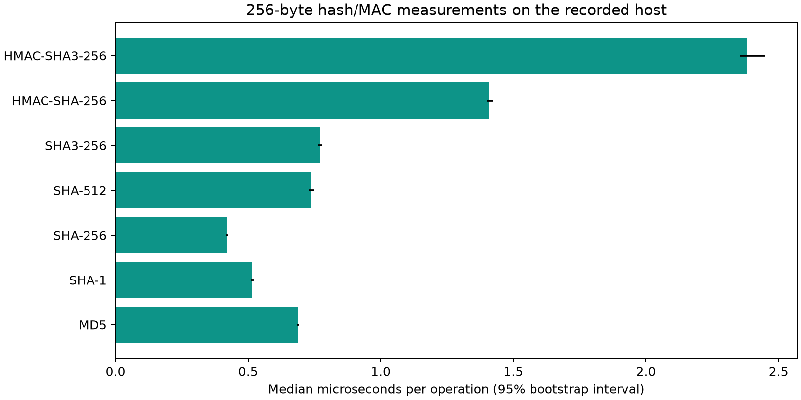
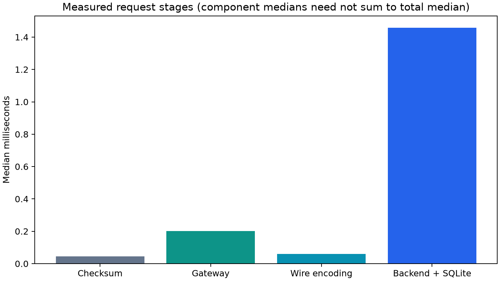

# Evaluating an Authenticated SHA-3 Retrofit for Legacy EV Charging: A Reproducible OCPP 1.6 Study

SecureCharge project team

Research prototype / paper draft - revised 6 October 2026. Author names and affiliation must be added by the team before submission. Not peer reviewed.

## Abstract

Legacy EV-charging integrations may use unkeyed checksums to detect changes to
messages or meter records. Replacing MD5 with a stronger unkeyed hash improves
collision resistance, but it still does not authenticate who sent a message.
SecureCharge evaluates an HMAC-SHA3-256 retrofit for a defined OCPP 1.6 action
profile and keeps these two weaknesses separate. We place a published MD5 collision
pair inside a synthetic, fully specified 128-byte meter-record format, then carry
the records in schema-valid OCPP SignedData samples. The two decoded records share
the same pinned MD5 yet differ by 128 Wh; their base64 encodings and full JSON
messages do not collide. Our outer transport authenticates the unchanged OCPP CALL
and binds it to a charger, key, timestamp and nonce. A SQLite transaction couples
replay protection with billing, retry responses and charger enrollment. The
evaluation records {{tests}} passing tests, real localhost WebSocket exchanges and
{{samples}} observations for each timing configuration on one desktop host. The
StartTransaction pipeline measured {{median_ms}} ms at the median and {{p95_ms}} ms
at p95, adding {{overhead}} bytes to the request. In a separate mutual-TLS outage
experiment, the gateway retained a stop request, the backend committed its bill
before the reply was lost, and journal recovery returned {{pilot_bills}} bill from
{{pilot_events}} custody events. Altered journal data was rejected. Detecting a
valid rollback of the journal suffix still depends on an independently stored
anchor. These experiments do not demonstrate physical power-loss durability or
operation with a real charger. SecureCharge contributes a reproducible integration
and evaluation of collision boundaries, authenticated transport and recovery; it
does not introduce a new cryptographic primitive, a JSON collision, a vendor
vulnerability finding or Raspberry Pi performance results.

Keywords: OCPP 1.6; SHA-3; MD5 collisions; legacy retrofit; authenticated transport; reproducibility; EV charging.

## 1. Introduction

An EV charging session turns meter readings into a financial record. In the OCPP
1.6 profile implemented here, StartTransaction supplies the initial energy counter
and StopTransaction supplies the final one. The charging station management system
(CSMS) bills their nonnegative difference at a fixed tariff. If a reading can be
changed without detection, the recorded bill can change even when the energy
delivered does not. This study therefore examines a specific legacy design
assumption: a vendor integration checks an unkeyed digest of a business message or
of a decoded binary meter record. OCPP itself does not require MD5.

The word “integrity” can hide two different failures. An attacker can edit a
message and recompute an unkeyed checksum; this requires no collision and works
even with a stronger unkeyed hash. Alternatively, an attacker may substitute a
different input with the same digest while leaving a previously pinned digest
unchanged. Whether that collision matters depends on exactly which bytes the
system hashes and how it interprets them. A collision between binary records does
not imply a collision between their base64 encodings or JSON wrappers.

We ask three questions. First, what do checksum recomputation and collision
substitution permit in a clearly specified, OCPP-carried legacy record model?
Second, can an authenticated SHA-3 transport preserve the original OCPP parser
input while detecting tampering, identity substitution, replay and downgrade after
enrollment? Third, what timing costs and persistent-state failures appear when
authentication is measured alongside accounting and retry recovery?

The paper answers these questions with a synthetic collision-boundary artifact,
a runnable adapter protocol, regression tests for accounting and recovery, and a
reproducible measurement package. The cryptographic mechanisms themselves are
established techniques; our contribution is their integration and evaluation in
this explicit charging model.

## 2. Background and related work

Wang and Yu described practical MD5 collision techniques [1]. We reuse the
published 128-byte collision pair documented by Selinger [2]; SecureCharge does
not search for a new collision. RFC 6151 explains why MD5 should not be used where
collision resistance is required [3]. Later chosen-prefix work on SHA-1 shows how
the feasibility and impact of a collision depend on an application's constraints
[8]. We reproduce no SHA-1 collision.

NIST specifies SHA3-256 in FIPS 202 [4]. Although it belongs to the Keccak sponge
family, SHA3-256 and raw Keccak-256 use different domain-separation conventions
and are not interchangeable [10]. HMAC is a standard construction for keyed
message authentication [5]. HMAC-SHA-256 would also be a suitable baseline; we
use SHA-3 to meet the project requirement, not because HMAC-SHA-256 is broken.
Neither a plain checksum nor a naive secret-prefix hash provides the guarantees
of HMAC.

The Open Charge Alliance's customization guidance describes broader extension
options in OCPP 2.0.1 than in OCPP 1.6 [6]. Adding a `customData` property to an
OCPP 1.6 billing payload would therefore not establish compatibility with a strict
1.6 parser. SecureCharge instead carries its metadata in an outer transport
envelope; adapters at both endpoints remove that envelope and pass the original
CALL to the parser. This does not replace the security-profile and TLS work needed
for deployment [7]. Likewise, MAC generation needs an unambiguous byte encoding:
our SC-JSON-1 profile is deliberately specified, but it is not RFC 8785/JCS [9].

Taken together, this prior work motivates two separate design choices: hash only
the bytes the application actually trusts, and authenticate messages with a key.
SecureCharge evaluates both choices alongside charger identity, staged migration
and durable billing effects. This is an engineering study rather than a claim of
a new cryptographic result. Establishing novelty for a particular publication
venue will require a wider, systematic comparison with prior retrofit and OCPP
security studies.

## 3. System and adversary model

The system consists of a legacy charger or simulator, trusted charger-local
gateway, upgraded CSMS adapter, unchanged OCPP parser and SQLite state store.
The network adversary controls the gateway-to-CSMS path and can inspect, modify,
drop, duplicate or reorder messages. Algorithms and records are public. The
adversary does not know an uncompromised gateway's key.

Assumptions include trustworthy meter/local adapter inputs, protected per-charger
keys, sufficiently accurate clocks and an uncompromised backend. Deployment must
authorize receiving connections and protect remote transport using TLS. The local
network demonstration does not implement a complete OCPP security profile.

We evaluate five actions: StartTransaction, StopTransaction, MeterValues,
Heartbeat and BootNotification. Billing uses integer Wh and paise at INR 12/kWh,
rounded half-up to the paisa. This tariff is an experiment setting, not a market
claim or a complete commercial accounting model.

## 4. Collision-boundary experiment

MVR-128 is a deliberately specified research format: a 128-byte vendor record,
with a big-endian 31-bit cumulative Wh counter at offsets 16-19; the top bit is
reserved and remaining bytes are opaque vendor data. This format is synthetic,
not inferred from a real charger or firmware image. The Wang-Yu pair fits the
grammar and decodes to different counters.

The record is base64-encoded into an OCPP 1.6 sampledValue with format SignedData,
measurand Energy.Active.Import.Register and unit Wh. The full StopTransaction
also contains a meterStop equal to that decoded counter. The modeled legacy
verifier pins the expected MD5 of record A, decodes the sample in either message,
checks the same expected MD5 and checks agreement with meterStop. The attacker
substitutes record B without changing the pinned digest.

The decoded records share MD5 {{collision_md5}}. Their counters are
{{counter_a}} Wh and {{counter_b}} Wh, a difference of 128 Wh. Using the same
meterStart, the bills are INR {{collision_honest_bill}} and INR {{collision_forged_bill}}.
Both OCPP messages validate against independent schemas. SHA-256 and SHA3-256
distinguish the decoded records; the JSON MD5 values are different. A stored SC2
tag for A rejects B with BAD_TAG.

This experiment establishes exploitability of the specified decoded-record
checksum boundary. It does not establish chosen-prefix collisions in arbitrary
JSON, an OCPP-standard vulnerability, or adoption of MVR-128 by vendors. The
separate checksum-recomputation experiment changes meterStop and its stored digest,
underbilling INR 150.00 to INR 1.20 for every tested unkeyed checksum algorithm.

## 5. SC2 retrofit design

### 5.1 Parser-preserving outer transport

The envelope has format SecureCharge/2, an unchanged OCPP CALL, modeled legacy
checksum metadata and an optional security object. The security object contains
version SC2, key ID, receiving charger identity, gateway signing timestamp,
128-bit random nonce and 256-bit tag. The tag covers the entire CALL and all
metadata except itself, using a fixed domain-separation context.

tag = HMAC-SHA3-256(K[kid], context || SC-JSON-1(envelope without tag)).

The adapter validates and unwraps the original CALL. An unaware parser receives
no new payload property. Parser compatibility is verified for the supported action
profile, not claimed as complete behavioral compatibility for all chargers.

### 5.2 Encoding and validation

SC-JSON-1 uses sorted object keys, ASCII-escaped strings, no output whitespace,
integer magnitudes up to 2^53-1, and JSON boolean/null literals. It rejects floats,
NaN, duplicate properties, invalid Unicode, nesting above 24 and messages above
64 KiB. Wire whitespace need not match MAC encoding. Independent OCPP 1.6 schemas
validate action payloads and CALLRESULTs. This is not RFC 8785 Unicode serialization.

The verifier checks exact security fields, version/key, MAC, authorized charger
identity, signing freshness and OCPP payload semantics before persistent effects.
Default TTL and future skew are 120 s and 30 s. Original meter-event timestamps
are distinct from the gateway's signing freshness timestamp.

### 5.3 Durable effects and retries

The request acquires a SQLite write transaction, claims a nonce scoped by key,
checks a retained charger/request-ID cache, performs business effects and commits
accepted response facts, enrollment and audit state together. SQL uniqueness guards
one bill per transaction and one open transaction per connector. Charger ownership
is checked when closing a transaction.

An exact captured envelope returns REPLAY. A new envelope around the same CALL
returns saved response facts without repeating effects. Reusing a retained request
ID for different CALL data returns REQUEST_CONFLICT. A storage fault rolls back
nonce and business effects, allowing an unchanged fresh request to be retried.
The retention/namespace policy for chargers that reuse IDs remains deployment work.

### 5.4 Migration and replies

Monitor/warn accept vendor-checksummed messages from un-enrolled chargers. A first
accepted authenticated request enrolls its charger durably; subsequent unsigned
traffic is refused regardless of the global observation mode. Enforce requires
authentication for all chargers. The mechanism uses a MAC, not a public-key
digital signature, so we use “authenticated request” to avoid conflating them.

Private-link replies use a separate domain label and bind response, charger/key,
timestamp, request nonce and OCPP request ID. The gateway verifies them before
forwarding standard OCPP responses. HMAC does not provide non-repudiation or
confidentiality; the deployment pilot complements it with mutual TLS and device authorization.

### 5.5 Pi custody and outage recovery

The gateway appends an authenticated queued event before forwarding a CALL.
WAL/FULL SQLite commits establish local custody subject to filesystem and storage
sync assumptions [11]. A worker computes a fresh MAC over the original CALL at delivery time,
preserving its meter-event date. Transient transport failures retain the request
and use bounded exponential delay with jitter. A confirmed event is appended only
after authenticating the CSMS reply against that outstanding request. A lost reply
after remote bill commitment is recovered via the backend's retained request cache.

Each journal event authenticates journal identity, sequence, previous tag, key ID
and body under a separate HMAC-SHA3-256 context. Verification rejects changed,
missing interior or reordered events. An exported journal/sequence/head anchor
must be independently protected to detect whole-journal or valid suffix rollback.
HMAC holders can forge this evidence; it is not public-key non-repudiation. The
gateway journal is distinct from the backend's ordinary, unsealed audit table.

The gateway never invents success, transaction IDs or bills during an outage.
After a bounded response wait it closes the connection and requests retry with
the same OCPP ID. Local charging authorization and firmware buffering remain
charger-specific. The bounded pilot retains up to 5,000 requests/10,000 events,
with a 16 KiB original-CALL cap and operator-controlled archival/rotation.

### 5.6 Device connection policy

Exposed services require mutual TLS. Trusted client certificates contain one
URI SAN binding a charger to its URL and provisioned key owner. Client chain,
server hostname and trust checks use Python SSL [12]. WSS upstreams require a
client certificate/key. Connection/message rates, frame buffering and idle waiting
are bounded through websockets 15 [13]. This is an implemented pilot policy, not
full OCPP certification or a complete certificate lifecycle.

## 6. Security arguments and validation

Under HMAC-SHA3-256 unforgeability and protected keys, altering authenticated
structured data requires a MAC forgery. Exact parsing and canonical encoding avoid
duplicate-key interpretations. Identity checks prevent authenticated data being
accepted under a different charger or a key assigned to another charger.

Under trusted-clock and SQLite-transaction assumptions, an accepted fresh nonce
cannot be accepted twice under the same key. Expired nonce entries are purged only
after their messages cannot pass freshness. Atomic enrollment checks prevent tag
stripping from returning an enrolled charger to legacy acceptance.

These are conditional implementation arguments, not a new proof of HMAC or a
machine-checked formal protocol model. Tests include NIST known answers,
reference-HMAC equivalence, property-generated payload/tag mutations, concurrent
delivery, independent database connections, v1 replay-table migration, key rotation,
restart persistence, SQL fault injection and exact freshness boundaries.

The recorded validation run has {{tests}} tests, {{failures}} failures and
{{errors}} errors. Streamlit interactions and actual localhost WebSocket exchanges
are exercised. Passing tests cannot prove every possible adversarial execution.

## 7. Experimental methodology

The recorded environment was Python {{python}} on {{platform}}, machine {{machine}},
with {{openssl}}. The board model is {{board}}; the hardware class is {{hardware}}.
Measurement timestamp is {{measured_at}}. No Pi performance result is inferred.

For each of seven hash/MAC algorithms and 256, 4096 and 65536-byte inputs,
we collect {{samples}} samples of 50 repeated operations following 20 warm-up calls.
Algorithm execution order is randomized by seed 18 to reduce drift bias. The seed
does not control cryptographic randomness. We report median, p95, p99 and a
percentile bootstrap interval for the median using 1000 resamples.

The pipeline evaluates modeled checksum, gateway verification/signing, wire
serialization and backend/SQLite processing of StartTransaction. A StopTransaction
closes each session outside the start-request timer. Ten sessions warm the path.
Storage is {{storage}}. Python allocation sampling occurs separately with
tracemalloc, without perturbing the reported latency observations.

All observations, methods and environment metadata are exported. SHA-256 manifests
identify source modules and artifact contents. The seed makes order/bootstrap
resampling reproducible; scheduler timings and random keys/nonces remain variable.
These intervals describe within-run resampling, not independent-machine uncertainty.

## 8. Results

The separate fault experiment ran on {{pilot_host}} at {{pilot_date}}.
It used actual mutual-TLS localhost WebSockets with a private temporary CA. An
unavailable upstream retained a pending stop with no success response. A restored
backend committed a bill and deliberately dropped its reply; reopening the journal
and retrying recovered an authenticated result with {{pilot_bills}} ledger entry
and {{pilot_events}} custody events. An unchanged retry returned the cached response;
modifying a journal record caused startup authentication failure. A separate
automated test terminates a child process abruptly after it commits a custody event. Neither
experiment establishes physical power-cut durability. TLS/custody costs are outside
the following core StartTransaction pipeline timings.

| Quantity | Recorded result |
|---|---|
| Start pipeline median | {{median_ms}} ms |
| Start pipeline p95 / p99 | {{p95_ms}} / {{p99_ms}} ms |
| Median 95% bootstrap interval | {{ci_low_ms}} - {{ci_high_ms}} ms |
| Original / wrapped start bytes | {{ocpp_bytes}} / {{envelope_bytes}} |
| Added envelope bytes | {{overhead}} |
| Python allocation peak for separate start+stop | {{allocation}} bytes |
| Automated tests | {{tests}} passed; {{failures}} failed; {{errors}} errors |
| Concurrent stop regression | One committed bill for sixteen distinct valid stops |
| WebSocket retry experiment | One ledger entry; INR 150.00 |
| Collision substitution | Both legacy records accepted; SC2 BAD_TAG |

Figure 1. Median hash/MAC latency for a 256-byte input, with bootstrap intervals.
Higher cost does not imply stronger authentication: unkeyed hashes remain forgeable
by recomputation regardless of the performance comparison.

Figure 2. Median request-stage costs on the recorded host. Component medians need
not sum to the median total. This is a start-request measurement, not network RTT,
full-session latency, firmware timing or physical energy measurement.

The unchanged JSON parser input establishes the implemented compatibility property.
The real WebSocket test returns a CSMS transaction ID, closes a session, repeats
the same business request without a second ledger entry and rejects wire tampering.
We report outcomes for the enumerated catalogue and regressions, not an attack
blocking percentage generalized to all possible attacks.

## 9. Limitations and threats to validity

The collision format is synthetic and intentionally exposes a concrete binary
hashing boundary. It does not prove vendor prevalence or feasibility of chosen-prefix
collisions under arbitrary vendor constraints. The published pair is precomputed.
Stronger hashes distinguish these particular records but that observation alone
does not establish general cryptographic security.

The measurement host is a single desktop/server environment. Warm-cache effects,
OS scheduling, filesystem behavior and library versions influence observations.
Within-run bootstrap intervals can underestimate correlated or run-to-run variability.
Pi experiments should use multiple independent runs, recorded thermal/throttling
conditions and actual board identity. Raspberry Pi instructions are supplied, but
no remote board was accessed in this build.

The gateway cannot make false upstream measurements truthful. HMAC keys are
stored in software configuration; secure elements/provisioning systems are not
implemented. Symmetric authentication lacks non-repudiation. Clock compromise,
host compromise, resource exhaustion, full certificate lifecycle and hostile
firmware remain outside the demonstrated threat model. The backend audit table is
unsealed; the authenticated Pi custody chain needs independent anchors for rollback
and protected historical verification keys. Automatic witness delivery and archival
rotation are not implemented. Full-journal performance must be measured. Request
cache retention and reusable OCPP IDs need deployment policy.

The prototype supports five actions and is not a certified OCPP implementation.
The original loopback omits TLS; the separate pilot uses actual mutual TLS. Service
authentication/bounds and systemd templates do not constitute complete production-profile validation.
Cross-platform CI is configured; execution on those CI runners remains unverified
until the repository is hosted and the jobs run.

## 10. Conclusion and future work

This study shows why replacing MD5 alone is not a complete response to an
integrity problem. In our explicitly synthetic record model, two decoded records
share a pinned MD5 and produce different, schema-valid OCPP transactions. Separately,
an attacker can recompute any unkeyed checksum after editing a message. The SC2
prototype addresses message authenticity with an HMAC-protected outer envelope
while preserving the CALL presented to the existing parser. Its accounting and
recovery paths are evaluated together with replay handling and staged enrollment.

The evidence supports a prototype-level result on one desktop host and a bounded
localhost outage pilot. It does not establish vendor exposure, real-charger
compatibility, Raspberry Pi performance or physical power-loss durability. Before
submission as a research paper, the work needs named authors and affiliations, a
systematic review of related OCPP retrofit work, independent target-device
measurements, and external review of the protocol and novelty. Useful engineering
follow-up also includes a defined request-ID retention policy, complete key and
certificate lifecycle, independent custody-anchor delivery, and longer load and
power-loss experiments.

## References

[1] X. Wang and H. Yu. “How to Break MD5 and Other Hash Functions.” In *Advances in Cryptology - EUROCRYPT 2005*, Lecture Notes in Computer Science, vol. 3494, pp. 19-35. Springer, 2005. https://doi.org/10.1007/11426639_2.

[2] P. Selinger. “MD5 Collision Demo.” Dalhousie University. https://www.mscs.dal.ca/~selinger/md5collision/ (accessed 6 October 2026). Published collision fixture provenance.

[3] S. Turner and L. Chen. Updated Security Considerations for the MD5 Message-Digest and the HMAC-MD5 Algorithms. RFC 6151, 2011. https://www.rfc-editor.org/rfc/rfc6151.html

[4] National Institute of Standards and Technology. *SHA-3 Standard: Permutation-Based Hash and Extendable-Output Functions*. FIPS PUB 202, August 2015. https://doi.org/10.6028/NIST.FIPS.202.

[5] H. Krawczyk, M. Bellare and R. Canetti. HMAC: Keyed-Hashing for Message Authentication. RFC 2104, 1997. https://www.rfc-editor.org/rfc/rfc2104.html

[6] Open Charge Alliance. *Customizing OCPP Implementations*, version 1.1, 2020. https://openchargealliance.org/wp-content/uploads/2023/11/OCA-Customizing-OCPP-Implementations.pdf

[7] Open Charge Alliance. OCPP 1.6 Security Whitepaper, edition 4. https://openchargealliance.org/ocpp-info-whitepapers/ocpp-1-6-security-whitepaper-4th-edition/

[8] G. Leurent and T. Peyrin. “SHA-1 is a Shambles: First Chosen-Prefix Collision on SHA-1 and Application to the PGP Web of Trust.” In *29th USENIX Security Symposium (USENIX Security 20)*, pp. 1839-1856, 2020. https://www.usenix.org/conference/usenixsecurity20/presentation/leurent

[9] A. Rundgren, B. Jordan and S. Erdtman. *JSON Canonicalization Scheme (JCS)*. RFC 8785, June 2020. https://www.rfc-editor.org/rfc/rfc8785.html

[10] Team Keccak. Keccak Specifications Summary. https://keccak.team/keccak_specs_summary.html

[11] SQLite. “Write-Ahead Logging” and “PRAGMA synchronous.” https://www.sqlite.org/wal.html ; https://www.sqlite.org/pragma.html#pragma_synchronous (accessed 6 October 2026).

[12] Python Software Foundation. “ssl - TLS/SSL wrapper for socket objects.” Python 3 documentation. https://docs.python.org/3/library/ssl.html (accessed 6 October 2026).

[13] websockets. “Server (asyncio), version 15.0.” https://websockets.readthedocs.io/en/15.0/reference/asyncio/server.html (accessed 6 October 2026).

## Artifact availability and reproducibility

Source modules and tests are included in the project workspace. Run the commands
in README.md and docs/RASPBERRY_PI.md. The paper's measured values come from
artifacts/final/results.json and its validation count from artifacts/validation.xml.
Pilot values come from artifacts/pilot-final/pilot-results.json. Raw timing CSVs,
scenario CSV, decoded record fixtures and content/source manifests for both runs are
provided. Private keys and state databases must not be published. The paper is an
editable project draft, not an accepted publication; real authors/affiliation are
the team's responsibility before external submission.
